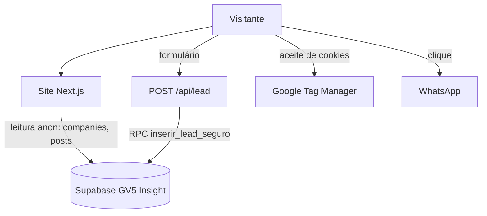

# Documentação do Software — GV5 Assessoria (site)

| Campo | Valor |
|---|---|
| **Versão do documento** | 1.1 |
| **Data** | 09/11/2026 |
| **Autor(es)** | Daniel (GV5 Assessoria) |
| **Status** | Em revisão |
| **Aprovado por** | A confirmar |

## Histórico de Revisões

| Versão | Data | Autor | Descrição da alteração |
|---|---|---|---|
| 1.0 | 09/11/2026 | Daniel | Criação do documento a partir do código do commit `9accc09` (visual pronto, com blog e formulário). |
| 1.1 | 09/11/2026 | Daniel | E-01/S01 obrigações do site: `/privacidade`, `/termos`, 404, `robots.txt` (com robôs de IA), `sitemap.xml` com os posts, `llms.txt`, canonical e Open Graph em todas as páginas e por post, imagem de compartilhamento e ícones em `public/essenciais/`, schema (ProfessionalService + FAQPage na home, BlogPosting + BreadcrumbList nos posts), blog renderizado no servidor com revalidação de 5 min e HTML sanitizado, "Leia também", banner de cookies + GTM após aceite, eventos `clique_whatsapp` e `envio_formulario` com UTM, UTM enviada junto do lead, headers de segurança/CSP, rodapé com links legais e âncoras absolutas, aviso de privacidade no formulário. Testado: `tsc`, `build`, CT-100 a CT-303 no `next start`. SQL: nenhum. |

---

## Sumário

1. [Visão Geral](#1-visão-geral)
2. [Escopo do Projeto](#2-escopo-do-projeto)
3. [Requisitos Funcionais](#3-requisitos-funcionais)
4. [Requisitos Não Funcionais](#4-requisitos-não-funcionais)
5. [Regras de Negócio](#5-regras-de-negócio)
6. [Projeto e Arquitetura do Software](#6-projeto-e-arquitetura-do-software)
7. [Plano e Casos de Teste](#7-plano-e-casos-de-teste)
8. [Matriz de Rastreabilidade](#8-matriz-de-rastreabilidade)
9. [Glossário](#9-glossário)
10. [Anexos e Referências](#10-anexos-e-referências)

---

## 1. Visão Geral

### 1.1 Propósito do documento
Descrever o que o site da GV5 faz hoje, a partir do código, para quem for mexer no projeto (pessoa ou IA) não precisar abrir arquivo à toa.

**Como ler**

| Domínio | Assunto | RF / RN | CT |
|---|---|---|---|
| 1 | Conteúdo da página e blog | 01–49 | 001–099 |
| 2 | Captação (formulário, WhatsApp) e rastreamento | 50–99 | 100–199 |
| 3 | SEO e arquivos do site | 100–149 | 200–299 |
| 4 | Legal e segurança | 150–199 | 300–399 |

**Fonte da verdade:** branch `obrigacoes-do-site` (a partir de `main` no commit `9accc09`), 09/11/2026. Onde este documento e o código divergirem, vale o código.

### 1.2 Descrição resumida do sistema
Landing page da própria GV5 Assessoria (Next.js 16, App Router, sem login). Apresenta a agência (tráfego pago focado em vendas para restaurantes e delivery), o método, serviços, planos com métricas, cases com ROAS, FAQ e um blog. A conversão principal é o formulário de **diagnóstico comercial** no topo da página, que grava o lead no banco do painel GV5 Insight.

| Parte | Quem usa | O que faz |
|---|---|---|
| Página inicial `/` | Dono de restaurante/delivery | Conhece a GV5 e envia o formulário ou chama no WhatsApp |
| `/blog`, `/blog/[slug]` | Visitante vindo da busca | Lê artigos publicados no painel GV5 Insight |
| `POST /api/lead` | Formulário da home | Valida e grava o lead no Supabase do painel |
| `/privacidade`, `/termos` | Visitante, Google/Meta Ads | Páginas legais (LGPD, CDC) |
| GTM (opcional) | GV5 (tráfego) | Mede visitas, cliques no WhatsApp e envios do formulário depois do aceite |

#### Dor que resolve
- Captar restaurantes interessados com dados de qualificação (segmento e faturamento) direto no painel comercial (`src/app/api/lead/route.ts:94`).
- Medir qual campanha trouxe cada contato: eventos com a origem da visita (`src/lib/origem.ts`).

#### Uso em produção (09/11/2026)

| Área | Números | O que mostram |
|---|---|---|
| Posts publicados da empresa `gv5` | 0 | O blog mostra o estado vazio; o sitemap ainda não lista artigos |

#### Público e papéis

| Público | Papel no sistema | Como usa |
|---|---|---|
| Dono ou gestor de restaurante/delivery | Visitante | Lê, envia o formulário, chama no WhatsApp |
| Equipe comercial GV5 | Recebe os leads | Atende pelo painel GV5 Insight (fora deste repositório) |
| Equipe de conteúdo GV5 | Publica artigos | Pelo painel GV5 Insight; o site só lê |

### 1.3 Stakeholders

| Nome / Papel | Responsabilidade | Contato |
|---|---|---|
| Daniel (GV5) | Site | A confirmar |
| Sócios GV5 | Aprovam conteúdo e dados da empresa | A confirmar |
| Gestor de tráfego (GV5) | GTM, Google Ads, Meta | A confirmar |

---

## 2. Escopo do Projeto

### 2.1 Objetivos do projeto
- Gerar leads qualificados de restaurantes e delivery pelo formulário de diagnóstico.
- Trazer visitas de busca pelo blog.
- Medir quais anúncios geram contatos.

### 2.2 In Scope (Dentro do escopo)
- Página inicial com as seções da 3.1, blog, rota de lead, páginas legais, 404, SEO, schema, cookies e GTM.

### 2.3 Out of Scope (Fora do escopo)
- Venda ou pagamento pelo site.
- Banco de dados próprio: tabelas `companies`, `posts` e `leads` são do GV5 Insight.

### 2.4 Premissas
- O Supabase do GV5 Insight libera leitura anônima de `companies` ativas e `posts` publicados (RLS do painel) e tem a RPC `inserir_lead_seguro` ou permite insert em `leads`.
- O GTM só carrega com `GTM_ID` em `src/lib/site.ts` ou `NEXT_PUBLIC_GTM_ID`.

### 2.5 Restrições
- Sem `cacheComponents`: blog, home e sitemap usam `export const revalidate = 300`.
- O limite de envios do formulário é em memória (`src/app/api/lead/route.ts:8`): reinicia a cada deploy e não é compartilhado entre instâncias.

### 2.6 Riscos identificados

| ID | Risco | Probabilidade | Impacto | Mitigação |
|---|---|---|---|---|
| R-01 | Domínio, razão social e Instagram sem confirmação (ver P-01 a P-03) | A confirmar | Médio (schema e páginas legais com dado errado) | Tudo centralizado em `src/lib/site.ts` |

### 2.7 Entregáveis
- Código em `src/`, imagens em `public/`, este documento e o `CLAUDE.md`.

### 2.8 Evoluções planejadas

**Em andamento:** E-01/S01 entregue; faltam os dados das pendências abaixo.

#### E-01 — Obrigações do site (aprovada em 09/11/2026)

Deixar o site pronto para publicar pelo checklist de landing page do Guia e pelo padrão de páginas dinâmicas (blog).

| ID | Decisão / Pendência | Bloqueia |
|---|---|---|
| D-01 | Sem página `/obrigado`: o formulário mostra o sucesso na própria tela (comportamento mantido). A conversão é o evento `envio_formulario` no dataLayer. | — |
| D-02 | Sem GTM configurado, não aparece banner de cookies (não há rastreador). | — |
| D-03 | A origem da visita (UTM, gclid, fbclid) vai no corpo do `POST /api/lead` como `origem`, mas não é gravada: a RPC e a tabela do painel só têm os 5 campos. | — |
| P-01 | Confirmar o domínio (`gv5assessoria.com.br`, tirado do README do repositório `gv5-assessoria`). | Publicação |
| P-02 | Razão social exata do CNPJ 64.530.042/0001-17 (o site usa "GV5 Assessoria de Marketing Digital", que é o nome do rodapé). | Publicação |
| P-03 | Perfil do Instagram (hoje o link vai para `instagram.com`). | — |
| P-04 | ID do GTM. | Medição |
| P-05 | E-mail de contato para LGPD e endereço da sede (comarca do foro nos termos). | — |
| P-06 | Gravar a origem do lead: criar colunas/parâmetros no GV5 Insight e repassar em `src/app/api/lead/route.ts`. | — |
| P-07 | Aprovar as propostas de title, description e H1 (relatório da S01). | — |
| P-08 | Revisar `/privacidade` e `/termos` com o jurídico. | — |

| Sprint | Entrega | Depende de | Testes | Status |
|---|---|---|---|---|
| S01 | Rotas, SEO, schema, blog no servidor, cookies/GTM, UTM, segurança, rodapé | — | CT-100 a CT-303 | entregue |
| S02 | Encaixar os dados de P-01 a P-07 | P-01 a P-07 | CT-201, CT-202 | pendente |

#### Ideias soltas (ainda sem conversa)

Nenhuma no momento.

---

## 3. Requisitos Funcionais

### 3.1 Visão funcional por domínio

**1. Conteúdo e blog.** A home (`src/app/page.tsx`) monta, nesta ordem: Formulário inicial com o H1 (`#inicio`), Hero, Clientes/cases (`#clientes`), Quem Somos (`#sobre`), Método (`#metodo`), Serviços (`#servicos`, cards em imagem), Planos (`#planos`), Time Exclusivo, Blog em destaque (`#blog`) e FAQ (`#faq`). O blog lê do Supabase do painel a empresa de slug `gv5` e os posts com `status = published`, no servidor, com revalidação de 5 minutos: post novo ou editado no painel aparece sozinho, sem deploy. Slug inexistente devolve 404.

**2. Captação e rastreamento.** O formulário pede um token ao abrir (`GET /api/lead`), envia nome, telefone, empresa, segmento e faturamento, e mostra o sucesso na tela. O WhatsApp aparece no rodapé, no botão flutuante, no card "seja você o próximo case" e na 404, sempre com mensagem pré-preenchida. O componente `Consentimento` guarda a origem da visita e manda eventos ao dataLayer; o GTM só carrega depois do "Aceitar".

**3. SEO e arquivos.** `metadataBase`, canonical e Open Graph em todas as páginas; por post, `generateMetadata` com tipo `article`. Sitemap com home, blog, posts e páginas legais; robots liberando os robôs de IA.

**4. Legal e segurança.** Páginas legais, banner de cookies, headers de segurança e CSP, HTML do blog sanitizado, honeypot + token assinado + limite por IP no formulário.

### 3.2 Lista de Requisitos Funcionais

Prioridade: Alta = conversão ou exigência legal; Média = SEO; Baixa = acabamento.

| ID | Descrição | Prioridade | Origem | Status |
|---|---|---|---|---|
| RF-01 | Home com as seções da 3.1 | Alta | `src/app/page.tsx:52` | Implementado |
| RF-02 | Lista de artigos `/blog` renderizada no servidor | Média | `src/app/blog/page.tsx:24` | Implementado |
| RF-03 | Página do artigo com data visível, capa, conteúdo sanitizado, CTA e "Leia também" | Média | `src/app/blog/[slug]/page.tsx:62` | Implementado |
| RF-04 | Três últimos artigos na home, buscados no servidor | Média | `src/components/sections/BlogDestaque/index.tsx` | Implementado |
| RF-05 | FAQ em acordeão | Baixa | `src/components/sections/Faq/index.tsx` | Implementado |
| RF-50 | Formulário de diagnóstico com envio para `POST /api/lead` | Alta | `src/components/sections/FormularioInicial/index.tsx:113` | Implementado |
| RF-51 | Rota de lead: honeypot, token, limite por IP, validação e gravação | Alta | `src/app/api/lead/route.ts:44` | Implementado |
| RF-52 | Links de WhatsApp com mensagem pré-preenchida | Alta | `src/lib/site.ts:30` | Implementado |
| RF-53 | Evento `clique_whatsapp` no dataLayer com seção, texto do botão, página e origem | Alta | `src/components/layout/Consentimento/index.tsx:39` | Implementado |
| RF-54 | Evento `envio_formulario` com segmento, faturamento e origem (sem dado pessoal) | Alta | `src/components/sections/FormularioInicial/index.tsx:135` | Implementado |
| RF-55 | Captura de UTM/gclid/fbclid na sessão e envio junto do lead (`origem`) | Média | `src/lib/origem.ts:10` | Implementado |
| RF-56 | GTM com Consent Mode v2 carregado só após "Aceitar" | Alta | `src/components/layout/Consentimento/index.tsx:57` | Implementado |
| RF-100 | `metadataBase`, canonical, Open Graph e ícones | Média | `src/app/layout.tsx:8` | Implementado |
| RF-101 | Metadata por post (title, description, canonical, OG `article`, capa ou imagem padrão) | Média | `src/app/blog/[slug]/page.tsx:34` | Implementado |
| RF-102 | `sitemap.xml` com posts publicados | Média | `src/app/sitemap.ts` | Implementado |
| RF-103 | `robots.txt` liberando robôs de busca e de IA | Média | `src/app/robots.ts` | Implementado |
| RF-104 | Schema ProfessionalService + FAQPage na home | Média | `src/app/page.tsx:26` | Implementado |
| RF-105 | Schema BlogPosting + BreadcrumbList nos posts | Média | `src/app/blog/[slug]/page.tsx:79` | Implementado |
| RF-106 | Página 404 com links para home, blog e WhatsApp | Baixa | `src/components/layout/NaoEncontrada/index.tsx` | Implementado |
| RF-107 | `llms.txt` | Baixa | `public/llms.txt` | Implementado |
| RF-150 | `/privacidade` com o conteúdo do art. 9 da LGPD e seção `#cookies` | Alta | `src/app/(legal)/privacidade/page.tsx` | Implementado |
| RF-151 | `/termos` | Alta | `src/app/(legal)/termos/page.tsx` | Implementado |
| RF-152 | Banner de cookies (Aceitar/Recusar) | Alta | `src/components/layout/Consentimento/index.tsx:65` | Implementado |
| RF-153 | Rodapé com razão social, CNPJ, ano atual e links legais | Alta | `src/components/layout/Rodape/index.tsx:92` | Implementado |
| RF-154 | Aviso de privacidade embaixo do botão do formulário | Alta | `src/components/sections/FormularioInicial/index.tsx:280` | Implementado |

### 3.3 Detalhamento

#### RF-51 — Rota de lead
- **Ator:** formulário da home.
- **Fluxo principal:**
  1. `GET /api/lead` devolve `{token, timestamp}`; o token é um HMAC-SHA256 de `ip-timestamp` com `LEADS_WEBHOOK_SECRET` (`route.ts:29-42`).
  2. `POST` confere o limite por IP, o honeypot, o token e valida os campos.
  3. Chama a RPC `inserir_lead_seguro` com `p_name`, `p_company_name`, `p_phone`, `p_segment`, `p_revenue`; se falhar, tenta insert direto em `leads` (`route.ts:94-120`).
  4. Responde `201 {success:true}`.
- **Exceções:** limite → 429; honeypot preenchido → 200 falso (o robô acha que deu certo); sem token ou token diferente → 403; campo inválido → 400; falha no banco → 500 com mensagem genérica.
- **Fonte:** `src/app/api/lead/route.ts`

#### RF-03 — Página do artigo
- **Fluxo:** busca o post pelo slug no servidor; não achou → `notFound()` (404 real). Mostra data de publicação e, se editado em outro dia, "Atualizado em". O HTML passa por `sanitizarHtml` (tira script, eventos, iframe; `<h1>` vira `<h2>`; link externo abre em nova aba com `noopener noreferrer`; imagens com `loading="lazy"`). "Leia também" lista até 3 outros posts.
- **Fonte:** `src/app/blog/[slug]/page.tsx`, `src/lib/sanitizarHtml.ts`

### 3.4 Endpoints

| Método | Rota | Acesso | Arquivo | O que faz |
|---|---|---|---|---|
| GET | `/api/lead` | público | `src/app/api/lead/route.ts:36` | Emite o token do formulário |
| POST | `/api/lead` | público, 5/min por IP | `src/app/api/lead/route.ts:44` | Grava o lead |

### 3.5 Telas

| Rota | Arquivo | Indexável |
|---|---|---|
| `/` | `src/app/page.tsx` | Sim |
| `/blog` | `src/app/blog/page.tsx` | Sim |
| `/blog/[slug]` | `src/app/blog/[slug]/page.tsx` | Sim |
| `/privacidade`, `/termos` | `src/app/(legal)/` | Sim |
| 404 | `src/app/not-found.tsx` | Não (`noindex`) |

---

## 4. Requisitos Não Funcionais

### 4.1 Lista (ISO 25010)

| ID | Característica | Descrição | Critério de Aceite / Métrica | Prioridade |
|---|---|---|---|---|
| RNF-01 | Segurança | Headers HSTS, X-Frame-Options DENY, nosniff, Referrer-Policy, Permissions-Policy e CSP | `next.config.ts` | Alta |
| RNF-02 | Segurança | HTML do blog sanitizado no servidor | `src/lib/sanitizarHtml.ts` | Alta |
| RNF-03 | Segurança | Limite de 5 envios por minuto por IP no formulário | `src/app/api/lead/route.ts:9-10` | Alta |
| RNF-04 | Desempenho | Páginas estáticas com revalidação de 300 s (home, blog, sitemap) | `revalidate = 300` | Média |
| RNF-05 | Confiabilidade | Falha ou vazio no Supabase não quebra a página: blog mostra estado vazio, destaque some | `src/integrations/supabase/client.ts:28-58` | Média |
| RNF-06 | Acessibilidade | `lang="pt-BR"`, `aria-label` nos campos do formulário, foco visível nos componentes novos | `src/app/layout.tsx`, `FormularioInicial` | Baixa |

### 4.2 Conformidade com a LGPD

| ID | Princípio LGPD | Descrição | Critério de Aceite | Prioridade |
|---|---|---|---|---|
| RNF-L01 | Consentimento | GTM só carrega depois do "Aceitar"; recusa é guardada | `Consentimento/index.tsx:57` | Alta |
| RNF-L02 | Transparência | `/privacidade` com controlador, dados, finalidades, compartilhamento, retenção, cookies e direitos | `src/app/(legal)/privacidade/page.tsx` | Alta |
| RNF-L03 | Minimização | Eventos do dataLayer não levam nome nem telefone | `FormularioInicial/index.tsx:135` | Alta |

---

## 5. Regras de Negócio

| ID | Descrição | Requisitos Relacionados |
|---|---|---|
| RN-01 | Blog mostra só posts com `status = published` da empresa `slug = gv5` com `status = active` (`src/integrations/supabase/client.ts:9`) | RF-02, RF-03 |
| RN-02 | Home mostra os 3 posts mais recentes por `published_at` (`BlogDestaque/index.tsx`) | RF-04 |
| RN-50 | Nome entre 2 e 80 caracteres (`route.ts:81`) | RF-51 |
| RN-51 | Empresa entre 2 e 100 caracteres (`route.ts:85`) | RF-51 |
| RN-52 | Telefone com 10 ou 11 dígitos depois de tirar o que não é número (`route.ts:89`) | RF-51 |
| RN-53 | Segmento e faturamento obrigatórios no navegador; vazio no servidor vira "Não informado" (`FormularioInicial/index.tsx:116`, `route.ts:98`) | RF-50 |
| RN-54 | Origem da visita só é gravada quando a URL traz UTM/gclid/fbclid; cada valor até 150 caracteres (`src/lib/origem.ts:10`) | RF-55 |
| RN-100 | Capa em Base64 não vai para o Open Graph: usa a imagem padrão do site (`blog/[slug]/page.tsx:26`) | RF-101 |

---

## 6. Projeto e Arquitetura do Software

### 6.1 Visão arquitetural
Next.js App Router. Páginas são Server Components; seções interativas são `"use client"` mas renderizadas no servidor (o texto está no HTML). Sem banco próprio: lê e grava no Supabase do GV5 Insight.

### 6.2 Diagrama



### 6.3 Stack Tecnológica

| Camada | Tecnologia |
|---|---|
| Front-end | Next.js 16.3.5, React 19.2.8, CSS Modules, anime.js 4, lucide-react, react-icons |
| Back-end | Route Handler do Next (`/api/lead`) |
| Banco | Supabase (PostgreSQL) do GV5 Insight, via `@supabase/supabase-js` 2 |
| Conteúdo | `sanitize-html` 2 |

### 6.4 Modelo de Dados
Tabelas do GV5 Insight usadas pelo site (fonte: `gv5-insight/supabase/migrations/0001_base_atual.sql`): `companies` (`id`, `slug`, `status`), `posts` (`id`, `company_id`, `title`, `slug`, `excerpt`, `content`, `cover_image`, `status`, `published_at`, `updated_at`) e `leads` (`name`, `company_name`, `phone`, `segment`, `revenue`).

### 6.5 Estrutura de Pastas

```text
src/
├── app/
│   ├── layout.tsx, page.tsx, global.css, not-found.tsx, robots.ts, sitemap.ts
│   ├── (legal)/privacidade/page.tsx, (legal)/termos/page.tsx
│   ├── api/lead/route.ts
│   └── blog/page.tsx, blog/[slug]/page.tsx (+ style.module.css)
├── components/
│   ├── effects/Faiscas/
│   ├── layout/Cabecalho, Rodape, PaginaLegal, NaoEncontrada, Consentimento
│   └── sections/BlogDestaque (index servidor + Conteudo cliente), Clientes, Faq (+ itens.ts), FormularioInicial, Hero, Metodo, Planos, QuemSomos, Servicos, TimeExclusivo
├── hooks/useScrollAnimation.ts
├── integrations/supabase/client.ts
└── lib/site.ts, origem.ts, sanitizarHtml.ts
public/
├── essenciais/icone.png, icone-apple.png, compartilhamento.jpg
├── cards/, clientes/, logo.png, hero.png, ...
└── llms.txt
```

### 6.6 Infra, variáveis e como rodar
- Variáveis (só nomes): `LEADS_WEBHOOK_SECRET`, `NEXT_PUBLIC_GTM_ID` (opcional).
- URL e chave anônima do Supabase estão no código (`src/integrations/supabase/client.ts:3-4`); a chave anônima é pública por natureza, quem protege é o RLS do painel.
- Rodar: `npm install`, `npm run dev`. Conferir: `npx tsc --noEmit`, `npm run build`.
- Imagens de `public/essenciais/` foram geradas com sharp a partir de `public/logo.png` (ícones) e `public/hero.png` (compartilhamento 1200×630).

---

## 7. Plano e Casos de Teste

### 7.1 Estratégia e Ambientes
- **Estratégia:** casos derivados do código; não há teste automatizado.
- **Ambientes:** local (`next start`). Produção: A confirmar.

### 7.2 Casos de Teste

| ID | Ref. | Cenário | Passos | Resultado Esperado |
|---|---|---|---|---|
| CT-001 | RF-02 | Blog sem posts | Abrir `/blog` | Estado "Nenhum artigo publicado" |
| CT-002 | RF-03 | Slug inexistente | Abrir `/blog/nao-existe` | Status 404 |
| CT-100 | RF-50, RF-51 | Envio válido | Preencher e enviar | 201 e tela de sucesso; lead no painel |
| CT-101 | RF-53 | Clique no WhatsApp | Clicar no botão do rodapé e ver `dataLayer` | Evento `clique_whatsapp` com `secao: rodape` |
| CT-102 | RF-55 | UTM | Abrir `/?utm_source=teste`, enviar formulário | Corpo do POST com `origem.utm_source = teste`; evento `envio_formulario` com a origem |
| CT-103 | RF-56, RF-152 | Consentimento | Com GTM_ID: abrir, Recusar; limpar dados, Aceitar | Recusar: sem `gtm.js`; Aceitar: `gtm.js` carrega |
| CT-200 | RF-103 | robots | Abrir `/robots.txt` | Regras para `*` e robôs de IA, linha `Sitemap` |
| CT-201 | RF-102 | sitemap | Abrir `/sitemap.xml` | Home, blog, posts publicados, privacidade e termos |
| CT-202 | RF-100, RF-104 | SEO da home | `Ctrl+U` em `/` | `title`, canonical, `og:image`, 2 blocos JSON-LD, um `h1` |
| CT-203 | RF-106 | 404 | Abrir `/qualquer-coisa` | Status 404, `noindex`, links para home/blog/WhatsApp |
| CT-300 | RNF-01 | Headers | `curl -I /` | CSP, HSTS, X-Frame-Options, Referrer-Policy |
| CT-301 | RF-150, RF-151 | Legais | Abrir `/privacidade` e `/termos` | Páginas com razão social, CNPJ e data |
| CT-302 | RF-153, RF-154 | Links legais | Ver rodapé e formulário | Links para as duas páginas e aviso de privacidade |
| CT-303 | RNF-02 | Sanitização | Post com `<script>` ou `onclick` | Some do HTML final |

---

## 8. Matriz de Rastreabilidade

| Requisito | Descrição | Caso(s) de Teste | Localização no Código | Status |
|---|---|---|---|---|
| RF-01 | Home | CT-202 | `src/app/page.tsx` | Implementado |
| RF-02 | Lista do blog | CT-001 | `src/app/blog/page.tsx` | Implementado |
| RF-03 | Artigo | CT-002, CT-303 | `src/app/blog/[slug]/page.tsx` | Implementado |
| RF-04 | Destaque na home | CT-202 | `src/components/sections/BlogDestaque/` | Implementado |
| RF-05 | FAQ | CT-202 | `src/components/sections/Faq/` | Implementado |
| RF-50 | Formulário | CT-100 | `src/components/sections/FormularioInicial/index.tsx` | Implementado |
| RF-51 | Rota de lead | CT-100 | `src/app/api/lead/route.ts` | Implementado |
| RF-52 | WhatsApp com mensagem | CT-101 | `src/lib/site.ts` | Implementado |
| RF-53 | Evento WhatsApp | CT-101 | `src/components/layout/Consentimento/index.tsx` | Implementado |
| RF-54 | Evento formulário | CT-102 | `src/components/sections/FormularioInicial/index.tsx` | Implementado |
| RF-55 | UTM | CT-102 | `src/lib/origem.ts` | Implementado |
| RF-56 | GTM após aceite | CT-103 | `src/components/layout/Consentimento/index.tsx` | Implementado |
| RF-100 | Metadata global | CT-202 | `src/app/layout.tsx` | Implementado |
| RF-101 | Metadata por post | CT-002 | `src/app/blog/[slug]/page.tsx` | Implementado |
| RF-102 | Sitemap | CT-201 | `src/app/sitemap.ts` | Implementado |
| RF-103 | Robots | CT-200 | `src/app/robots.ts` | Implementado |
| RF-104 | Schema home | CT-202 | `src/app/page.tsx` | Implementado |
| RF-105 | Schema post | CT-002 | `src/app/blog/[slug]/page.tsx` | Implementado |
| RF-106 | 404 | CT-203 | `src/components/layout/NaoEncontrada/` | Implementado |
| RF-107 | llms.txt | CT-200 | `public/llms.txt` | Implementado |
| RF-150 | Privacidade | CT-301 | `src/app/(legal)/privacidade/page.tsx` | Implementado |
| RF-151 | Termos | CT-301 | `src/app/(legal)/termos/page.tsx` | Implementado |
| RF-152 | Banner de cookies | CT-103 | `src/components/layout/Consentimento/` | Implementado |
| RF-153 | Rodapé legal | CT-302 | `src/components/layout/Rodape/index.tsx` | Implementado |
| RF-154 | Aviso no formulário | CT-302 | `src/components/sections/FormularioInicial/index.tsx` | Implementado |

---

## 9. Glossário

| Termo | Definição |
|---|---|
| Diagnóstico comercial | Nome do formulário da home: o lead pede uma conversa inicial com a equipe |
| GV5 Insight | Painel interno da GV5 onde ficam leads, empresas e posts do blog |
| ROAS | Retorno sobre o investimento em anúncios (receita ÷ investido), mostrado nos cases |
| Origem | Parâmetros do link de chegada (UTM, gclid, fbclid) guardados na sessão |
| dataLayer | Lista de eventos na página que o GTM lê |

---

## 10. Anexos e Referências

- Repositório: local, branch `main` (8 commits até `9accc09`, de 16/09/2026 a 30/09/2026).
- Guia: `checklist-landing-page`, `paginas-dinamicas-com-seo`, `regras-seguranca` §9.
- Implementação de referência: `Projetos/gv5assessoria/clubevidadecao`.

### 10.1 Achados

- **A-01.** `src/app/api/lead/route.ts:5`: se `LEADS_WEBHOOK_SECRET` não existir, o token do formulário é assinado com um texto fixo escrito no código.
- **A-02.** O formulário não usa `POST /api/leads` do GV5 Insight: grava direto pela RPC `inserir_lead_seguro` com a chave anônima (`route.ts:94`), com fallback de insert em `leads`.
- **A-03.** `segment` e `revenue` não têm limite de tamanho no servidor (`route.ts:98-99`).
- **A-04.** A seção Serviços mostra o conteúdo só em imagens (`public/cards/*.png`, alt genérico "Solução GV5 Assessoria"): o texto dos serviços não está no HTML.
- **A-05.** As ocorrências de "TODO" apontadas na auditoria eram falso positivo (palavras "todos" e "método"); não há lorem ipsum nem texto de exemplo esquecido. Os `TODO:` reais são os de `src/lib/site.ts`, `src/app/(legal)/termos/page.tsx` e `src/app/api/lead/route.ts`, criados na S01.
- **A-06.** `npm audit` aponta 12 vulnerabilidades (8 moderadas, 3 altas, 1 crítica) em dependências já existentes.

### 10.2 Como este documento foi levantado
Leitura do código do commit `9accc09` e das mudanças da E-01/S01; contagem de posts publicados pela API pública do Supabase (só `count`); schema das tabelas pelas migrations do repositório `gv5-insight`.
